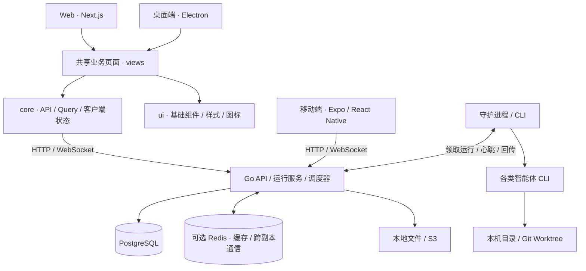

# Multica 项目架构与工程分析

Multica 已具备较完整的多人、多智能体协作平台架构。主要工程投入集中在运行可靠性、多端同步和运行时兼容上；后续应优先处理执行权限边界、部分 API 契约校验缺口，以及核心模块膨胀带来的维护成本。

分析基线为提交 `68bda1b0ff678b7f1027ce0a19c5a18a6f403bf4`。本文用于理解系统、评估维护风险和安排改进工作，结论来自仓库静态分析。功能正确性、实际性能和线上稳定性需要运行验证；文中的优先级表示建议处理顺序，不等同于漏洞严重程度。

## 产品模型

平台围绕一条工作闭环展开：用户提出任务，将其分配给智能体；智能体在指定运行时上执行，通过评论、日志和产物反馈，随后进入后续协作或审阅流程。

| 概念 | 代码或协议名称 | 职责 |
| --- | --- | --- |
| 工作区 | `workspace` | 成员、权限、资源和业务数据的主要隔离单位 |
| 任务 | `issue` | 长期保存需求、讨论、状态、关联资源和交付结果 |
| 智能体 | `agent` | 可被分配工作的身份，带有模型、skill、配置和运行时绑定 |
| 运行时 | `agent_runtime` | 描述可用的执行能力及其在线状态 |
| 守护进程 | daemon | 连接服务端，准备执行环境，启动和管理智能体进程 |
| 运行 | Run，API／数据库中为 `task` | 一次具体执行，具有排队、领取、运行和终态 |
| 聊天会话 | `chat_session` | 对话入口，可以驱动智能体执行 |
| 自动化 | `autopilot` | 按配置触发运行，并保存执行历史 |
| 唤醒与工作流 | wakeup、workflow | 根据时间、事件、条件或状态推进后续执行 |
| 扩展能力 | skill、plugin、MCP | 分别承担知识复用、平台扩展和工具接入 |

长期协作对象与单次运行分开，是这一模型的重要基础。一个任务可以经历多轮运行、失败重试和人工干预，运行历史仍然关联在同一业务上下文中。中文术语遵循[开发规范](../../apps/docs/content/docs/developers/conventions.zh.mdx)，避免将 `issue` 与 `task` 都称为任务。

## 整体架构

项目采用 Monorepo，包含 Go 后端、Web、桌面端、移动端、文档站，以及共享逻辑、业务页面和 UI 包。

| 目录 | 实际职责 | 维护重点 |
| --- | --- | --- |
| `server/` | API、权限、运行、调度、集成、CLI、守护进程、智能体适配 | 状态转换、事务、权限与进程生命周期 |
| `packages/core/` | API 客户端、Schema、Query、状态、实时同步和纯工具 | 共享行为与缓存一致性 |
| `packages/views/` | 业务页面、编辑器、运行日志和配置界面 | 页面职责、交互复杂度与多端复用 |
| `packages/ui/` | 基础组件、设计令牌、图标和 Markdown 基础能力 | 保持业务独立性与视觉一致性 |
| `apps/web/` | Next.js 路由、布局、认证和浏览器适配，也包含产品网站相关内容 | 框架边界、认证和运行时配置 |
| `apps/desktop/` | Electron、窗口、标签页、更新和守护进程管理 | 渲染器权限、IPC、会话与窗口协调 |
| `apps/mobile/` | 独立 UI、请求、缓存、状态和实时同步 | 原生交互、业务语义与跨端同步 |
| `apps/docs/` | 文档站 | 内容、引用与构建 |
| `packages/plugin-sdk/` | 插件页面与宿主通信接口 | 授权范围、通信协议与发布契约 |

`views → core + ui` 的依赖方向合理。框架和 Electron API 留在应用层，共享层通过导航、存储和其他平台适配能力接入，有利于 Web 与桌面端复用。

移动端独立维护原生交互和数据层，主要复用 core 类型、纯工具及平台无关 Schema。这能避免引入浏览器依赖，同时也增加了权限、未读数、缓存更新和重连行为的同步维护成本。

相关边界见[仓库约定](../../AGENTS.md)和[移动端约定](../../apps/mobile/AGENTS.md)。当前共享 ESLint 配置已有依赖声明、图标来源等检查；包层级的禁止依赖仍值得逐步转成静态约束，见[共享 ESLint 配置](../../packages/eslint-config/base.js)。

## 代码规模与复杂度分布

以下数据来自分析基线中 Git 跟踪的文件。代码行数统计 TS、TSX 和 Go，排除文件名含 `_test.go`、`.test.`、`.spec.` 以及路径含 `/generated/` 的文件；仍包含字典及其他生成内容，用于判断规模，不代表复杂度评分。

测试文件数按 `_test.go` 后缀或文件名中的 `.test.`、`.spec.` 统计，与测试用例数和覆盖率不同。

| 模块 | 近似代码行数 | 测试文件数 |
| --- | ---: | ---: |
| Go 后端、CLI、守护进程 | 339,075 | 1,454 |
| 共享业务页面 views | 206,668 | 562 |
| 共享逻辑 core | 54,473 | 209 |
| 移动端 | 31,865 | 44 |
| Web | 26,491 | 38 |
| 桌面端 | 16,468 | 72 |

此外，仓库有 638 个向上迁移文件，以及 39 个 E2E spec 文件，后者包含独立性能场景。测试数量体现了验证投入，实际质量仍取决于断言、场景选择和持续执行结果。

复杂度集中在运行生命周期和共享业务界面，几个热点文件如下：

| 文件 | 行数 |
| --- | ---: |
| [daemon.go](../../server/internal/daemon/daemon.go) | 11,144 |
| [service/task.go](../../server/internal/service/task.go) | 8,412 |
| [handler/daemon.go](../../server/internal/handler/daemon.go) | 6,848 |
| [api/client.ts](../../packages/core/api/client.ts) | 5,611 |
| [handler/issue.go](../../server/internal/handler/issue.go) | 5,080 |
| [issue-detail.tsx](../../packages/views/issues/components/issue-detail.tsx) | 4,131 |

行数本身不能证明设计错误，但这些文件集中处理执行、权限、缓存或交互，变更时需要理解较大的上下文。适合围绕运行领取、环境准备、执行控制和结果结算逐步拆分职责，并用现有行为测试约束拆分过程。

## 运行执行与故障恢复

运行主要通过 PostgreSQL 中的 `agent_task_queue` 管理。用户分配任务或其他触发源产生运行后，服务端安排入队，守护进程领取并准备环境，启动智能体 CLI，再回传过程消息和最终结果。

[运行领取 SQL](../../server/pkg/db/queries/agent.sql) 中的 `ClaimAgentTask` 使用 `FOR UPDATE SKIP LOCKED`，并检查运行时在线状态、心跳新鲜度、智能体当前绑定、已有活动运行和优先级。同一个任务下，同一智能体的运行需要串行，不同智能体可以并行。

[运行服务](../../server/internal/service/task.go)和[守护进程](../../server/internal/daemon/daemon.go)已考虑多种故障情况：

- `dispatched` 阶段和准备租约处理已领取、尚未真正启动的窗口。
- 心跳、新鲜度判断和离线处理支持运行时故障检测。
- 失败原因分类、重试和会话恢复判断支持后续执行。
- 取消传播和进程树管理控制子进程生命周期。
- 独立目录、本地目录及 Git Worktree 支持不同工作方式。
- 最终结果落盘和重放降低网络中断导致结果丢失的风险。

[持久化补报队列](../../server/internal/daemon/terminal_report_queue.go)将最终回调按运行保存到文件，支持退避、永久拒绝判断和隔离。记录不包含认证 Token，重放使用守护进程的当前凭据。

[本地 Worktree 实现](../../server/internal/daemon/execenv/local_worktree.go)还处理用户未提交修改的快照、分支归属、会话继续和遗留修改保存。这一层直接关系到代码交付和用户工作是否保留，重构时应优先保持这些行为。

执行层已有较深入的可靠性设计。对应的回归场景应稳定覆盖以下情况：

| 故障窗口 | 需要验证的结果 |
| --- | --- |
| 领取成功但响应丢失 | 后续恢复遵循租约和状态规则，避免旧领取覆盖新执行 |
| 环境准备期间守护进程退出 | 运行能够恢复或明确失败，状态不会长期悬挂 |
| 取消与完成同时到达 | 终态及副作用符合统一的结算规则 |
| 运行完成时网络中断 | 结果保留并按补报规则重试 |
| 会话恢复失败 | 用户能识别连续性变化，结果仍关联正确任务 |
| 工作区撤权或运行时解绑 | 后续领取与进行中的执行遵循权限变化 |

这些机制降低了重复执行和状态悬挂风险，仍需故障注入验证其组合行为；静态分析不能证明任意运行都只执行一次。

## 前端状态与实时一致性

Web 与桌面端共享数据职责：TanStack Query 保存服务端数据，Zustand 保存筛选、草稿、模态框和标签页等客户端状态，WebSocket 负责更新或失效 Query 缓存。

[任务变更实现](../../packages/core/issues/mutations.ts)和相关缓存协调模块处理列表、详情、收件箱、运行及关联投影之间的同步。乐观更新已考虑取消请求、快照回滚和重新读取，能够减少旧请求覆盖已保存修改等问题。

[Query 默认配置](../../packages/core/query-client.ts)使用 `staleTime: Infinity`，并关闭窗口聚焦刷新，主要依靠事件维持数据新鲜度。部分查询覆盖为较短失效时间；[实时同步](../../packages/core/realtime/use-realtime-sync.ts)也在重连和工作区切换时补刷数据。

这能减少请求量，同时使事件完整性成为正确性的关键依赖。新增事件时，需要同时检查详情、列表、统计、未读和跨端投影，不能只验证当前页面。

[WS 客户端](../../packages/core/api/ws-client.ts)具有指数退避和抖动，但当前没有可见的断线状态或手动重试入口。持续断线时，依赖事件刷新的页面可能继续显示旧数据，用户难以判断同步是否仍在进行。连接状态、恢复反馈和重试入口应与已有补刷机制一起完善。

性能方面已经有明确投入：[运行消息](../../packages/core/realtime/use-realtime-sync.ts)会批量写缓存，[本地搜索客户端](../../packages/core/search-index/client.ts)使用 Worker，在不可用或超时时回到服务端搜索；[性能场景](../../e2e/perf/README.md)关注实时输入、聊天列表和浮动聊天生命周期。

实际输入延迟、内存占用和大型工作区容量仍需要运行性能场景测量。后续优化适合围绕这些已有场景进行，避免仅根据文件规模推导性能瓶颈。

## API 契约与客户端兼容

已安装的桌面端可能连接更新的服务端，因此响应兼容是产品运行条件。[Schema 边界](../../packages/core/api/schema.ts)已经提供 `parseWithFallback`，校验失败时记录问题并返回调用方指定的回退值。

当前确认存在契约校验缺口：[API 客户端](../../packages/core/api/client.ts)中的 `listAgents`、`getAgent` 和 `createAgent` 直接返回 `this.fetch()`；底层 `fetch<T>` 通过 `res.json() as Promise<T>` 接收 JSON。[工作区查询](../../packages/core/workspace/queries.ts)直接消费智能体列表与详情，[创建提交逻辑](../../packages/views/agents/create/use-create-agent-submit.ts)也消费创建响应。

类型声明无法阻止异常响应进入 UI。这与[仓库 API 兼容要求](../../AGENTS.md)存在差距，应优先补齐这些核心接口，再盘点其他直接消费 JSON 的路径。

校验时还需区分读取和写入的语义。列表读取可以按契约降级为空结果；创建响应损坏时应避免显示成功或丢失草稿。已有 `createIssue` 路径使用空值回退后拒绝异常响应，可以参考其失败处理原则，而不必统一成同一种回退结果。

## 权限与执行安全

服务端、桌面渲染器、插件内容和本机执行分别具有不同权限边界，需要分别评估。

[认证中间件](../../server/internal/middleware/auth.go)已有 Cookie 认证对应的 CSRF 校验，并区分 JWT、个人 Token 和运行 Token。运行 Token 绑定工作区、智能体及运行身份；中间件会清理客户端伪造的智能体和运行身份头。

[工作区中间件](../../server/internal/middleware/workspace.go)处理成员和角色校验，限制运行 Token 跨工作区使用；[WebSocket Hub](../../server/internal/realtime/hub.go)包含来源、成员和订阅范围相关检查。这些机制明确区分了成员身份与智能体执行身份。

### 桌面渲染器

[渲染器配置](../../apps/desktop/src/main/renderer-web-preferences.ts)显式设置 `sandbox: true`，保留上下文隔离与关闭 Node 集成的安全默认值，同时设置 `webSecurity: false`。此外还有[文档导航保护](../../apps/desktop/src/main/navigation-guard.ts)。

`webSecurity: false` 削弱浏览器同源和跨域保护，是需要处理的安全技术债。代码已说明恢复保护依赖于从 `file://` 迁移到具有明确来源的自定义协议，并协调服务端来源配置。应将协议、CORS、附件预览和窗口导航作为完整迁移处理。静态分析尚未证明存在可利用链路。

### 插件页面

[插件 SDK 说明](../../packages/plugin-sdk/README.md)和[页面宿主](../../packages/views/plugins/plugin-surface-frame.tsx)采用可信包装页面加内部插件 iframe 的结构。实际插件代码运行在不授予 `allow-same-origin` 的 iframe 中，网络访问受声明范围和 CSP 限制，调用同时受插件授权与当前用户权限约束。

评估时应区分外层可信包装 iframe 与内部插件 iframe，不能仅凭外层 sandbox 属性推断隔离强度。浏览器侧机制在桌面端配置下的实际行为仍需要专门验证。

### 本机执行

[Claude 启动实现](../../server/pkg/agent/claude.go)使用 `bypassPermissions`；[Codex 默认执行策略](../../server/internal/daemon/execenv/codex_sandbox.go)在 Linux 使用 `danger-full-access`，其他平台还有各自的兼容判断和配置处理。代码明确将主机隔离交给守护进程所处的 VM、容器或专用用户边界。

这是产品设计取舍。独立目录、Git Worktree 和平台审阅状态各自解决不同问题，本机资源访问能力仍由执行身份和宿主隔离决定。运行不可信仓库脚本时，应按该身份实际拥有的文件、凭据和网络权限评估影响范围。

## 数据库与升级

[sqlc 配置](../../server/sqlc.yaml)从 SQL 查询和迁移生成类型化访问代码。运行和定时调度使用数据库协调；[调度管理器](../../server/internal/scheduler/manager.go)包含计划领取、租约续期、失败记录和重试逻辑。

[迁移执行器](../../server/cmd/migrate/main.go)使用会话级 advisory lock 串行化并发迁移，不将整轮迁移包在单一事务中，以支持并发索引。[迁移集合检查](../../server/internal/migrations/migrations.go)提供完整版本集合，避免只检查最后版本而遗漏乱序迁移。

638 个向上迁移文件使升级路径成为重要产品能力。需要持续验证空库初始化、代表性历史版本升级、中断后重跑，以及条件跳过迁移后的后续 DDL。

仓库现行规则禁止新增外键和级联删除，将关系校验及清理放在应用层；历史迁移仍能看到外键定义，不能由现行规则推断实际数据库完全没有外键。删除、归档和撤权流程需要结合最终 Schema、事务边界及依赖清理顺序验证。

## 部署与可观测性

[自托管 Compose](../../docker-compose.selfhost.yml)和[Helm 配置](../../deploy/helm/multica/values.yaml)支持基本自托管部署。本地文件与 S3 提供不同存储方式，Redis 用于可选缓存及跨副本通信。

多副本部署除 API 进程数量外，还涉及跨副本事件、长连接归属和共享文件存储。Helm 默认上传卷为 `ReadWriteOnce`，增加副本时需要同步评估 S3 或共享卷配置。[自托管说明](../../SELF_HOSTING.md)还记录了企业微信长连接在不同 relay 模式下的多副本限制。

[读副本选择器](../../server/internal/dbreader/selector.go)以主库为默认，仅对显式允许最终一致性的业务启用读副本，并对特定可用性错误提供回退和熔断。这个边界有助于避免把状态转换误路由到延迟副本。

[商业策略消费者说明](../../server/internal/entitlement/README.md)明确将套餐和商业策略输入留在私有 Cloud，当前仓库消费策略指令。未配置 Cloud URL 时，基础自托管路径保持独立；评估托管商业能力时，需要将仓库实现与外部服务边界一起考虑。

[业务指标](../../server/internal/metrics/business.go)已覆盖排队等待、运行时长、终态、失败、租约、Token 和成本等信息。后续适合围绕以下问题组织监控与排障视图：

- 运行等待多久，领取后多久真正开始。
- 失败来自环境准备、智能体进程、运行时离线还是结果结算。
- 最终结果补报是否积压，永久拒绝是否需要处理。
- 多副本事件和长连接消息是否正常交付。
- 客户端断线后是否恢复同步。

指标定义提供了基础，生产告警覆盖和定位效率还需要实际运行数据验证。

## 测试与发布保障

[主 CI](../../.github/workflows/ci.yml)包含前端构建、类型检查、Lint、分片测试，后端 race 测试、vet、漏洞扫描、sqlc 一致性检查，以及 Windows／macOS 运行时专项验证。[发布流程](../../.github/RELEASING.md)规定通过标签触发发布，并在发布前执行 Go 测试和漏洞扫描。

验证投入较充分，主要补强空间在集成交互层：

| 范围 | 当前配置 | 需要补强的能力 |
| --- | --- | --- |
| Web 端到端 | 有 Playwright 配置和 E2E 场景，主 CI 未定义常规 Playwright 执行 job | 为关键协作闭环配置持续执行的冒烟测试 |
| 桌面端 | [桌面冒烟](../../.github/workflows/desktop-smoke.yml)为手动触发 | 关键窗口、认证、守护进程管理和内容隔离验证 |
| 前端性能 | [性能工作流](../../.github/workflows/ui-performance.yml)为手动触发 | 为高频交互保留可比较的性能基线 |
| 移动端 | [移动端 CI](../../.github/workflows/mobile-verify.yml)执行类型、Lint 和测试；[Vitest](../../apps/mobile/vitest.config.ts)主要覆盖纯函数和无原生依赖的数据逻辑 | 键盘、Sheet、导航、长列表及原生渲染验证 |
| 静态质量 | [共享检查](../../.github/actions/frontend-quality/action.yml)执行 UI 规则，knip 为非阻断检查 | 渐进减少既有发现，并将重要包边界转成自动约束 |

运行生命周期、权限与缓存转换应由稳定测试负责；真实智能体的账号访问和运行仅在明确授权下进行，遵循[仓库真实智能体测试约定](../../AGENTS.md)。

## 改进优先级

| 优先级 | 发现或边界 | 影响 | 建议交付 |
| --- | --- | --- | --- |
| 高 | 桌面端 `webSecurity: false` | 浏览器同源和跨域保护减弱 | 自定义协议、服务端来源配置及恢复保护的完整迁移 |
| 高 | 核心智能体 API 缺少运行时 Schema 校验 | 异常响应可能进入 UI，新旧版本混用时更难定位 | 列表、详情、创建的校验及异常响应回归测试 |
| 高 | 本机执行依赖宿主隔离 | 执行能力受守护进程身份实际权限控制 | 明确部署边界，并验证文件、凭据和网络权限范围 |
| 中高 | 运行核心文件职责集中 | 评审、修改和回归成本较高 | 按领取、准备、执行、结算职责渐进拆分 |
| 中 | WS 缺少可见断线状态 | 用户可能误判旧数据仍在更新 | 连接状态、恢复反馈及重试入口 |
| 中 | 关键集成场景依赖本地或手动执行 | 多层组合错误可能较晚发现 | 持续执行的最小业务闭环和原生交互验证 |
| 中 | 包边界主要依赖约定与评审 | 随规模增长容易出现跨层耦合 | 对核心禁止依赖建立静态检查 |
| 中 | 迁移和扩容组合较多 | 历史升级及多副本配置容易遗漏 | 代表性升级矩阵和共享存储、事件交付检查 |

这些建议需要分别形成范围明确的变更。推荐按以下依赖关系推进：

1. 补齐已确认的 API 契约缺口，并建立对应失败场景测试。
2. 明确桌面、本机执行和插件的权限边界，验证实际行为，再安排迁移。
3. 固定分配、领取、完成、取消、断线补报、撤权和多端同步的关键回归场景。
4. 在行为测试约束下拆分运行热点模块。
5. 持续补充历史升级、多副本通信和共享文件存储验证。

## 验证记录

本次分析实际完成了仓库和代码检查、规模统计、13 个 JSON 清单／配置解析、23 个根目录 Shell 脚本的 `bash -n` 语法检查，以及 `git diff --check`。这些静态检查均通过。

分析环境中的 Node 为 `18.20.4`，低于仓库要求的 Node 22，且缺少 pnpm、Go、Docker 和已安装依赖，因此未运行应用、类型检查、单元测试、E2E 或性能测试。本文不表示这些检查已经通过，也不构成完整安全审计。

文档引用以相对路径指向仓库源码，事实和规模对应上述提交。代码变化后，应先复核对应实现再沿用结论。
